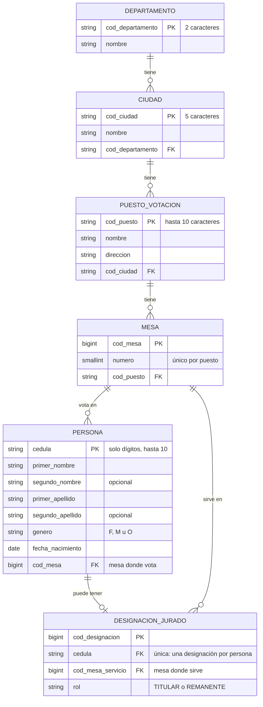

# ConsultaVoto — Proyecto de portafolio QA

> ⚠️ **Proyecto ficticio de demostración.** ConsultaVoto no es un sitio oficial ni está conectado a ningún registro electoral real. Todos los nombres, cédulas, puestos y mesas son datos inventados.

Aplicación web full stack de consulta electoral, construida como **sistema bajo prueba** para mostrar buenas prácticas de Quality Engineering y automatización de pruebas en varios niveles: unitario, API, BDD y E2E.

## Funcionalidad

- El usuario ingresa su número de cédula.
- La app muestra su **lugar de votación**: puesto, dirección, ciudad, departamento y mesa.
- Si el ciudadano fue designado **jurado de votación**, muestra además su asignación: rol, puesto y mesa de servicio.
- Maneja los casos de **campo vacío**, **formato inválido** y **cédula no encontrada**.

## Stack

| Capa | Tecnología |
|------|------------|
| Backend | Python 3.11, Django 5.2 LTS, Django REST Framework |
| Base de datos | MySQL 8.0 |
| Frontend | React + Vite |
| Pruebas unitarias / integración | pytest + pytest-django |
| Pruebas de API | pytest + requests |
| BDD | pytest-bdd (Gherkin en español) |
| E2E / UI | Playwright para Python |
| CI | GitHub Actions |

## Modelo de datos

Definido en [`backend/apps/consultas/models.py`](backend/apps/consultas/models.py).



**Reglas de negocio reflejadas en el modelo**

| Regla | Cómo se implementa |
|-------|--------------------|
| Una persona sin designación es **solo votante** | `DesignacionJurado` es opcional (relación 1 a 0..1 con `Persona`) |
| Un jurado puede servir en una mesa o puesto **distinto** a donde vota | `Persona.mesa` y `DesignacionJurado.mesa_servicio` son relaciones independientes |
| El puesto y la dirección de servicio no se duplican | Se obtienen a través de `mesa_servicio.puesto` |
| No hay dos mesas con el mismo número en un puesto | Restricción `mesa_unica_por_puesto` |
| La cédula admite valores de 10 dígitos sin desbordamiento | `cedula` es texto (`CharField(max_length=10)`), no entero |
| La edad nunca queda desactualizada | No se almacena: se calcula desde `fecha_nacimiento` (`calcular_edad(fecha_referencia)`) |
| Los datos de referencia no se borran en cascada | Las relaciones usan `PROTECT`; solo la designación se elimina con su persona |

### Datos de demostración

El fixture [`datos_demo.json`](backend/apps/consultas/fixtures/datos_demo.json) usa la **división política real** de Colombia (33 departamentos con códigos DIVIPOLA del DANE) y datos **inventados** para puestos, mesas y personas. Las cédulas siguen el formato colombiano, de 7 a 10 dígitos. Cada persona cubre un escenario de prueba: solo votante, jurado en la misma mesa, jurado en otra mesa del mismo puesto y jurado en otro puesto, además de casos borde (sin segundo nombre o apellido, nacimiento un 29 de febrero, cédulas antiguas).

## API

`POST /api/consulta/` con `{"cedula": "1098765432"}`. La cédula va en el cuerpo y no en la URL, para que no quede registrada en logs ni historiales.

```json
{
  "ciudadano": { "cedula": "1098765432", "nombre_completo": "Carlos Andrés Martínez", "edad": 36 },
  "lugar_votacion": { "mesa": 18, "puesto": "Colegio Cívico La Esperanza", "direccion": "Calle 48 # 65-20", "ciudad": "Medellín", "departamento": "Antioquia" },
  "jurado": { "rol": "TITULAR", "rol_display": "Jurado titular", "mesa": 18, "puesto": "Colegio Cívico La Esperanza", "direccion": "Calle 48 # 65-20", "ciudad": "Medellín", "departamento": "Antioquia", "misma_mesa": true }
}
```

`jurado` es `null` cuando la persona solo vota. Todos los errores responden `{"codigo", "mensaje"}`:

| HTTP | `codigo` | Cuándo |
|------|----------|--------|
| 400 | `CEDULA_REQUERIDA` | Cédula vacía o ausente |
| 400 | `CEDULA_FORMATO_INVALIDO` | No son de 6 a 10 dígitos sin 0 inicial (letras, puntos, comas, espacios internos) |
| 404 | `CEDULA_NO_ENCONTRADA` | Cédula no registrada |
| 400 / 415 | `SOLICITUD_INVALIDA` | El cuerpo no es un objeto JSON válido |
| 405 | `METODO_NO_PERMITIDO` | Método distinto de POST |
| 429 | `DEMASIADAS_CONSULTAS` | Más de 30 consultas por minuto desde la misma IP (configurable con `CONSULTA_LIMITE_POR_MINUTO`) |

## Estrategia de pruebas

```
            ┌───────────┐
            │    E2E    │  Playwright + Page Object Model
            ├───────────┤
            │    BDD    │  pytest-bdd, escenarios de negocio en Gherkin
            ├───────────┤
            │    API    │  Black-box contra la API REST
            ├───────────┤
            │ Unitarias │  White-box de validadores y servicios
            └───────────┘
```

- **Page Object Model** compartido entre E2E y BDD (`tests/support/pages/`), con localizadores por rol y nombre accesible.
- **Los mismos features BDD** se ejecutan por dos canales: la API y la interfaz.
- **Accesibilidad automatizada** con axe-core (WCAG 2.1 A/AA) en cada pantalla.
- **Pruebas de mutación**: las reglas de negocio y de seguridad se comprobaron reintroduciendo el defecto.
- **`conftest.py` por nivel** para aislar fixtures.
- **Datos de prueba externos** en `tests/data/`, nunca quemados en los tests.
- **Markers** (`api`, `bdd`, `e2e`, `smoke`, `regression`) para ejecutar suites selectivas.

## Estructura del proyecto

```
.
├── .github/workflows/ci.yml   # Pipeline de CI (placeholder)
├── backend/                   # API Django + DRF
│   ├── config/                # Proyecto Django y settings por entorno
│   ├── apps/consultas/        # App de dominio: modelos, admin, validadores, servicios, vistas
│   │   ├── migrations/        # Migraciones de la base de datos
│   │   └── fixtures/          # Datos de demostración (datos_demo.json)
│   ├── manage.py
│   ├── pytest.ini             # Configuración de pytest-django (settings de test)
│   └── tests/                 # Pruebas white-box (pytest-django)
├── frontend/                  # React + Vite
│   ├── vite.config.js         # Proxy de /api hacia el backend
│   └── src/
│       ├── pages/             # Una página por pantalla: consulta, resultado y 404
│       ├── components/        # layout/, common/, consulta/, resultado/ (cada uno con su CSS Module)
│       ├── services/          # Cliente de la API (único módulo que hace peticiones)
│       ├── hooks/             # useConsultaCedula: valida, consulta y navega
│       ├── utils/             # Validación, formatos, rutas y textos del jurado
│       ├── assets/            # Íconos e ilustraciones del Figma
│       └── styles/            # Tokens de diseño y estilos globales
├── tests/                     # Pruebas black-box contra la app en ejecución
│   ├── data/                  # Datos de prueba (JSON)
│   ├── support/               # Cliente de API, configuración y Page Objects
│   ├── api/                   # Pruebas de API
│   ├── bdd/                   # features/ (Gherkin) + step_defs/api y step_defs/interfaz
│   └── e2e/                   # Flujo, errores, accesibilidad y pantallas pequeñas con Playwright
├── pytest.ini                 # Configuración y markers de las pruebas black-box
└── .env.example               # Variables de entorno requeridas
```

## Estado del proyecto

| Componente | Estado |
|------------|--------|
| Estructura del monorepo | ✅ |
| Modelo de datos y migración inicial | ✅ |
| Settings de Django por entorno (`local`, `test`) | ✅ |
| Datos de demostración (fixture) | ✅ |
| Admin de Django para revisar los datos | ✅ |
| API REST de consulta (`POST /api/consulta/`) | ✅ |
| Pruebas white-box del backend (pytest-django, 77 pruebas) | ✅ |
| Pruebas black-box de la API (pytest + requests, 59 pruebas) | ✅ |
| Pruebas BDD (pytest-bdd, Gherkin en español): 14 casos contra la API y 14 contra la interfaz | ✅ |
| Frontend React: base y layout común (fase 1 de 4) | ✅ |
| Frontend React: pantalla de consulta con sus estados de error (fase 2 de 4) | ✅ |
| Frontend React: pantalla de resultado para votante y jurado (fase 3 de 4) | ✅ |
| Frontend React: accesibilidad, pantallas pequeñas y 404 (fase 4 de 4) | ✅ |
| Pruebas E2E (Playwright, 112 casos, con auditoría de accesibilidad) en Chromium, Firefox y WebKit | ✅ |
| Pipeline de CI | 🚧 Placeholder |

## Ejecución

### Requisitos

- Python 3.11 (Django 5.2 LTS; Django 6 exige Python 3.12+)
- MySQL 8.0 en local
- Windows / PowerShell en los ejemplos. En Linux o macOS el entorno se activa con `source .venv/bin/activate`.

### 1. Entorno virtual y dependencias

Un solo entorno en la raíz para el backend y las pruebas:

```powershell
python -m venv .venv
.venv\Scripts\Activate.ps1
pip install -r backend/requirements.txt -r tests/requirements.txt
python -m playwright install        # navegadores para las pruebas E2E
```

### 2. Base de datos

Con un usuario administrador de MySQL, crea la base y un usuario propio del proyecto. `test_registraduria` es la base temporal que pytest-django crea y borra en cada corrida de pruebas:

```sql
CREATE DATABASE registraduria CHARACTER SET utf8mb4 COLLATE utf8mb4_0900_ai_ci;
CREATE USER 'consultavoto_app'@'localhost' IDENTIFIED BY '<contraseña>';
GRANT ALL PRIVILEGES ON registraduria.* TO 'consultavoto_app'@'localhost';
GRANT ALL PRIVILEGES ON test_registraduria.* TO 'consultavoto_app'@'localhost';
```

### 3. Variables de entorno

Copia la plantilla y completa los valores. El archivo `.env` nunca se sube al repositorio:

```powershell
Copy-Item .env.example .env
python -c "from django.core.management.utils import get_random_secret_key; print(get_random_secret_key())"
```

Obligatorias: `DJANGO_SECRET_KEY`, `MYSQL_DATABASE`, `MYSQL_USER` y `MYSQL_PASSWORD`. Las demás tienen valores por defecto para desarrollo local (ver comentarios en [`.env.example`](.env.example)).

### 4. Migraciones, datos de demostración y superusuario

```powershell
cd backend
python manage.py migrate
python manage.py loaddata datos_demo
python manage.py createsuperuser
```

### 5. Levantar el backend

```powershell
python manage.py runserver
```

Admin en http://127.0.0.1:8000/admin/: muestra departamentos, ciudades, puestos, mesas, personas (con filtro "es jurado") y designaciones de jurado.

Probar la API desde PowerShell (con el servidor corriendo):

```powershell
Invoke-RestMethod -Method Post -Uri http://127.0.0.1:8000/api/consulta/ `
  -ContentType 'application/json' -Body '{"cedula": "1098765432"}' | ConvertTo-Json -Depth 5
```

### 6. Pruebas del backend

```powershell
cd backend
pytest
```

pytest-django crea la base `test_registraduria`, carga los datos de demostración y la borra al terminar.

### 7. Pruebas black-box: API, BDD y E2E

Se ejecutan contra la aplicación en marcha y con los datos de demostración cargados. Hacen muchas peticiones seguidas, así que el backend se levanta con un límite de consultas alto. En una terminal:

```powershell
$env:CONSULTA_LIMITE_POR_MINUTO = "1000"
cd backend
python manage.py runserver
```

Las pruebas de interfaz también necesitan el frontend. En otra terminal (ver el paso 8):

```powershell
cd frontend
npm run dev
```

En una tercera terminal, desde la raíz del repositorio:

```powershell
pytest tests/api                     # API (no necesita el frontend)
pytest tests/bdd -m "bdd and api"    # escenarios BDD contra la API
pytest tests/bdd -m "bdd and e2e"    # escenarios BDD contra la interfaz
pytest tests/e2e                     # E2E en Chromium
pytest tests/e2e --headed            # E2E viendo el navegador
pytest tests/bdd tests/e2e -m e2e --browser chromium --browser firefox --browser webkit
pytest tests -m smoke                # subconjunto crítico de todas las suites
```

| Suite | Casos | Qué cubre |
|-------|-------|-----------|
| `tests/api` | 59 | Contrato de la API, validaciones y protocolo HTTP |
| `tests/bdd` | 28 | 14 escenarios de negocio, por la API y por la interfaz |
| `tests/e2e` | 112 | Navegación, privacidad, formato, errores, fallas de red, accesibilidad y pantallas pequeñas |

Los escenarios están en [`tests/bdd/features/`](tests/bdd/features) y los datos de prueba en [`tests/data/`](tests/data). Las URL se toman de `API_BASE_URL` y `FRONTEND_BASE_URL` en el `.env` (por defecto `http://127.0.0.1:8000` y `http://localhost:5173`). Si falta algún servidor, la corrida se detiene con instrucciones.

La auditoría con axe-core detecta solo una parte de los problemas de accesibilidad: no reemplaza una revisión con lector de pantalla.

### 8. Frontend

Requiere Node.js. Con el backend corriendo (paso 5), en otra terminal:

```powershell
cd frontend
npm ci          # instala las versiones exactas de package-lock.json
npm run dev     # http://localhost:5173
```

En desarrollo, Vite reenvía las peticiones a `/api` hacia el backend (`API_BASE_URL` del `.env`, por defecto `http://127.0.0.1:8000`), así que no hace falta configurar CORS.

Cédulas de ejemplo para recorrer la aplicación (todas ficticias):

| Cédula | Qué se ve |
|--------|-----------|
| `1023456789` | Solo votante, con su edad y el consejo "Antes de ir a votar" |
| `1098765432` | Jurado en la misma mesa donde vota |
| `1017234568` | Jurado remanente en otra mesa del mismo puesto |
| `1036845120` | Jurado en otro puesto |
| `1000000000` | Cédula no encontrada |

El resultado viaja en el estado de navegación, nunca en la URL: si se recarga la página o se entra directo a `/consulta/resultado`, la aplicación vuelve a `/consulta`. Con el límite normal de 30 consultas por minuto, muchas pruebas seguidas muestran "Hiciste demasiadas consultas".

### Pendiente

- Pipeline de CI y reportes de pruebas

## Aviso

Este repositorio es un proyecto de portafolio con fines educativos. No representa a ninguna entidad oficial y no debe usarse para consultar información electoral real.
