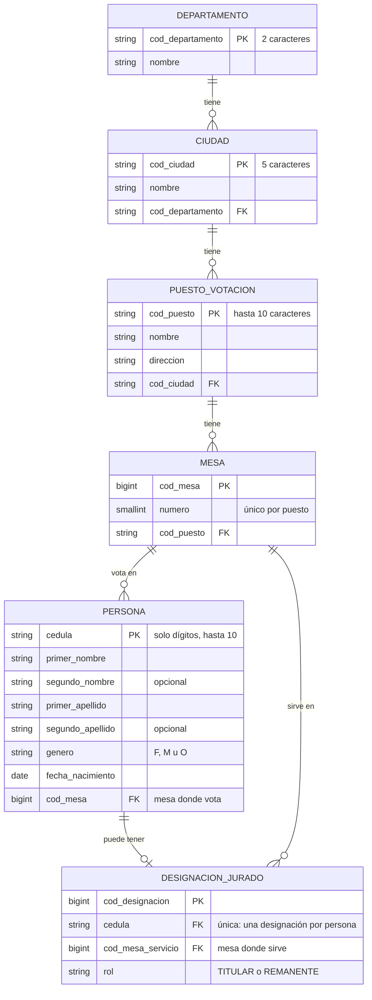

# ConsultaVoto — Proyecto de portafolio QA

> ⚠️ **Proyecto ficticio de demostración.** ConsultaVoto no es un sitio oficial ni está conectado a ningún registro electoral real. Todos los nombres, cédulas, puestos y mesas son datos inventados.

Aplicación web full stack de consulta electoral, construida como **sistema bajo prueba** para mostrar buenas prácticas de Quality Engineering y automatización de pruebas en varios niveles: unitario, API, BDD y E2E.

## Funcionalidad

- El usuario ingresa su número de cédula.
- La app muestra su **lugar de votación**: puesto, dirección, ciudad, departamento y mesa.
- Si el ciudadano fue designado **jurado de votación**, muestra además su asignación: rol, puesto y mesa de servicio.
- Maneja los casos de **campo vacío**, **formato inválido** y **cédula no encontrada**.

## Stack

| Capa | Tecnología |
|------|------------|
| Backend | Python 3.11, Django 5.2 LTS, Django REST Framework |
| Base de datos | MySQL 8.0 |
| Frontend | React + Vite |
| Pruebas unitarias / integración | pytest + pytest-django |
| Pruebas de API | pytest + requests |
| BDD | pytest-bdd (Gherkin en español) |
| E2E / UI | Playwright para Python |
| CI | GitHub Actions |

## Modelo de datos

Definido en [`backend/apps/consultas/models.py`](backend/apps/consultas/models.py).



**Reglas de negocio reflejadas en el modelo**

| Regla | Cómo se implementa |
|-------|--------------------|
| Una persona sin designación es **solo votante** | `DesignacionJurado` es opcional (relación 1 a 0..1 con `Persona`) |
| Un jurado puede servir en una mesa o puesto **distinto** a donde vota | `Persona.mesa` y `DesignacionJurado.mesa_servicio` son relaciones independientes |
| El puesto y la dirección de servicio no se duplican | Se obtienen a través de `mesa_servicio.puesto` |
| No hay dos mesas con el mismo número en un puesto | Restricción `mesa_unica_por_puesto` |
| La cédula admite valores de 10 dígitos sin desbordamiento | `cedula` es texto (`CharField(max_length=10)`), no entero |
| La edad nunca queda desactualizada | No se almacena: se calcula desde `fecha_nacimiento` (`calcular_edad(fecha_referencia)`) |
| Los datos de referencia no se borran en cascada | Las relaciones usan `PROTECT`; solo la designación se elimina con su persona |

## Estrategia de pruebas

```
            ┌───────────┐
            │    E2E    │  Playwright + Page Object Model
            ├───────────┤
            │    BDD    │  pytest-bdd, escenarios de negocio en Gherkin
            ├───────────┤
            │    API    │  Black-box contra la API REST
            ├───────────┤
            │ Unitarias │  White-box de validadores y servicios
            └───────────┘
```

- **Page Object Model** compartido entre E2E y BDD (`tests/support/pages/`).
- **`conftest.py` por nivel** para aislar fixtures.
- **Datos de prueba externos** en `tests/data/`, nunca quemados en los tests.
- **Markers** (`api`, `bdd`, `e2e`, `smoke`, `regression`) para ejecutar suites selectivas.

## Estructura del proyecto

```
.
├── .github/workflows/ci.yml   # Pipeline de CI (placeholder)
├── backend/                   # API Django + DRF
│   ├── config/                # Proyecto Django y settings por entorno
│   ├── apps/consultas/        # App de dominio: modelos, validadores, servicios, vistas
│   └── tests/                 # Pruebas white-box (pytest-django)
├── frontend/                  # React + Vite
│   └── src/
│       ├── pages/             # Una página por pantalla del diseño
│       ├── components/        # layout/, common/, consulta/, resultado/
│       ├── services/          # Cliente de la API
│       ├── hooks/
│       ├── utils/
│       └── styles/            # Tokens de diseño y estilos globales
├── tests/                     # Pruebas black-box contra la app en ejecución
│   ├── data/                  # Datos de prueba (JSON)
│   ├── support/               # Cliente de API, configuración y Page Objects
│   ├── api/                   # Pruebas de API
│   ├── bdd/                   # features/ (Gherkin) + step_defs/
│   └── e2e/                   # Pruebas de UI con Playwright
├── pytest.ini                 # Configuración y markers de las pruebas black-box
└── .env.example               # Variables de entorno requeridas
```

## Ejecución

🚧 **Pendiente.** Se documentará al completar la implementación:

- Crear la base de datos y el usuario en MySQL 8.0
- Ejecutar backend y frontend en local
- Correr cada suite de pruebas y generar reportes

## Aviso

Este repositorio es un proyecto de portafolio con fines educativos. No representa a ninguna entidad oficial y no debe usarse para consultar información electoral real.
