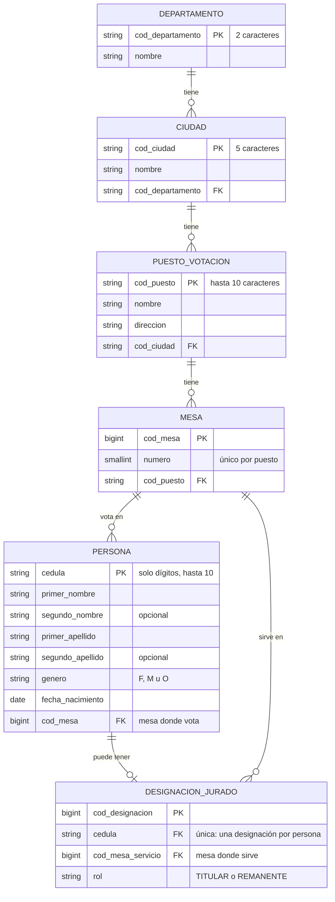

# ConsultaVoto — Proyecto de portafolio QA

[](https://github.com/crisprog2/ClaudeProyectoRegistraduria/actions/workflows/ci.yml)
[](https://crisprog2.github.io/ClaudeProyectoRegistraduria/)

> ⚠️ **Proyecto ficticio de demostración.** ConsultaVoto no es un sitio oficial ni está conectado a ningún registro electoral real. Todos los nombres, cédulas, puestos y mesas son datos inventados.

Aplicación web full stack de consulta electoral, construida como **sistema bajo prueba** para mostrar buenas prácticas de Quality Engineering y automatización de pruebas en varios niveles: unitario, API, BDD y E2E.

## Funcionalidad

- El usuario ingresa su número de cédula.
- La app muestra su **lugar de votación**: puesto, dirección, ciudad, departamento y mesa.
- Si el ciudadano fue designado **jurado de votación**, muestra además su asignación: rol, puesto y mesa de servicio.
- Maneja los casos de **campo vacío**, **formato inválido** y **cédula no encontrada**.

## Stack

| Capa | Tecnología |
|------|------------|
| Backend | Python 3.11, Django 5.2 LTS, Django REST Framework |
| Documentación de la API | OpenAPI 3.1 y Swagger UI (drf-spectacular) |
| Base de datos | MySQL 8.0 con el controlador PyMySQL |
| Frontend | React + Vite |
| Pruebas unitarias / integración | pytest + pytest-django |
| Pruebas de API | pytest + requests |
| BDD | pytest-bdd (Gherkin en español) |
| E2E / UI | Playwright para Python |
| Reportes de pruebas | Allure 3 (allure-pytest) |
| CI | GitHub Actions |

## Modelo de datos

Definido en [`backend/apps/consultas/models.py`](backend/apps/consultas/models.py).



**Reglas de negocio reflejadas en el modelo**

| Regla | Cómo se implementa |
|-------|--------------------|
| Una persona sin designación es **solo votante** | `DesignacionJurado` es opcional (relación 1 a 0..1 con `Persona`) |
| Un jurado puede servir en una mesa o puesto **distinto** a donde vota | `Persona.mesa` y `DesignacionJurado.mesa_servicio` son relaciones independientes |
| El puesto y la dirección de servicio no se duplican | Se obtienen a través de `mesa_servicio.puesto` |
| No hay dos mesas con el mismo número en un puesto | Restricción `mesa_unica_por_puesto` |
| La cédula admite valores de 10 dígitos sin desbordamiento | `cedula` es texto (`CharField(max_length=10)`), no entero |
| La edad nunca queda desactualizada | No se almacena: se calcula desde `fecha_nacimiento` (`calcular_edad(fecha_referencia)`) |
| Los datos de referencia no se borran en cascada | Las relaciones usan `PROTECT`; solo la designación se elimina con su persona |

### Datos de demostración

El fixture [`datos_demo.json`](backend/apps/consultas/fixtures/datos_demo.json) usa la **división política real** de Colombia (33 departamentos con códigos DIVIPOLA del DANE) y datos **inventados** para puestos, mesas y personas. Las cédulas siguen el formato colombiano, de 7 a 10 dígitos. Cada persona cubre un escenario de prueba: solo votante, jurado en la misma mesa, jurado en otra mesa del mismo puesto y jurado en otro puesto, además de casos borde (sin segundo nombre o apellido, nacimiento un 29 de febrero, cédulas antiguas).

## API

Con el backend corriendo, la documentación interactiva está en http://127.0.0.1:8000/api/docs/ (Swagger UI). La especificación OpenAPI está en http://127.0.0.1:8000/api/schema/ y se puede importar en Postman.

`POST /api/consulta/` con `{"cedula": "1098765432"}`. La cédula va en el cuerpo y no en la URL, para que no quede registrada en logs ni historiales.

```json
{
  "ciudadano": { "cedula": "1098765432", "nombre_completo": "Carlos Andrés Martínez", "edad": 36 },
  "lugar_votacion": { "mesa": 18, "puesto": "Colegio Cívico La Esperanza", "direccion": "Calle 48 # 65-20", "ciudad": "Medellín", "departamento": "Antioquia" },
  "jurado": { "rol": "TITULAR", "rol_display": "Jurado titular", "mesa": 18, "puesto": "Colegio Cívico La Esperanza", "direccion": "Calle 48 # 65-20", "ciudad": "Medellín", "departamento": "Antioquia", "misma_mesa": true }
}
```

`jurado` es `null` cuando la persona solo vota. Todos los errores responden `{"codigo", "mensaje"}`:

| HTTP | `codigo` | Cuándo |
|------|----------|--------|
| 400 | `CEDULA_REQUERIDA` | Cédula vacía o ausente |
| 400 | `CEDULA_FORMATO_INVALIDO` | No son de 6 a 10 dígitos sin 0 inicial (letras, puntos, comas, espacios internos) |
| 404 | `CEDULA_NO_ENCONTRADA` | Cédula no registrada |
| 400 / 415 | `SOLICITUD_INVALIDA` | El cuerpo no es un objeto JSON válido |
| 405 | `METODO_NO_PERMITIDO` | Método distinto de POST |
| 429 | `DEMASIADAS_CONSULTAS` | Más de 30 consultas por minuto desde la misma IP (configurable con `CONSULTA_LIMITE_POR_MINUTO`) |

## Estrategia de pruebas

```
            ┌───────────┐
            │    E2E    │  Playwright + Page Object Model
            ├───────────┤
            │    BDD    │  pytest-bdd, escenarios de negocio en Gherkin
            ├───────────┤
            │    API    │  Black-box contra la API REST
            ├───────────┤
            │ Unitarias │  White-box de validadores y servicios
            └───────────┘
```

- **Page Object Model** compartido entre E2E y BDD (`tests/support/pages/`), con localizadores por rol y nombre accesible.
- **Los mismos features BDD** se ejecutan por dos canales: la API y la interfaz.
- **Accesibilidad automatizada** con axe-core (WCAG 2.1 A/AA) en cada pantalla.
- **La documentación de la API se prueba**: las respuestas reales se validan contra la especificación OpenAPI, así que los campos no documentados y los ejemplos desactualizados hacen fallar la suite.
- **Pruebas de mutación**: las reglas de negocio y de seguridad se comprobaron reintroduciendo el defecto.
- **`conftest.py` por nivel** para aislar fixtures.
- **Datos de prueba externos** en `tests/data/`, nunca quemados en los tests.
- **Markers** (`api`, `bdd`, `e2e`, `smoke`) para ejecutar suites selectivas. Correr todo sin filtros es la regresión completa.
- **Integración continua** con GitHub Actions: todas las suites en cada pull request, con la lógica en un script reutilizable.
- **Un solo reporte de Allure** con los cuatro niveles. Los escenarios BDD muestran cada paso de Gherkin, y las pruebas fallidas adjuntan su evidencia: la petición y la respuesta de la API o la captura y la traza de Playwright.

## Estructura del proyecto

```
.
├── .github/
│   ├── workflows/ci.yml       # Pipeline de CI (GitHub Actions)
│   └── actions/preparar-entorno/  # Pasos comunes del CI: Python, clave de Django y permisos de MySQL
├── scripts/pruebas.py         # Corre las suites levantando y apagando los servidores (local y CI)
├── backend/                   # API Django + DRF
│   ├── config/                # Proyecto Django y settings por entorno
│   ├── apps/consultas/        # App de dominio: modelos, admin, validadores, servicios, vistas, documentación OpenAPI
│   │   ├── migrations/        # Migraciones de la base de datos
│   │   └── fixtures/          # Datos de demostración (datos_demo.json)
│   ├── manage.py
│   ├── pytest.ini             # Configuración de pytest-django (settings de test)
│   └── tests/                 # Pruebas white-box (pytest-django)
├── frontend/                  # React + Vite
│   ├── vite.config.js         # Proxy de /api hacia el backend
│   └── src/
│       ├── pages/             # Una página por pantalla: consulta, resultado y 404
│       ├── components/        # layout/, common/, consulta/, resultado/ (cada uno con su CSS Module)
│       ├── services/          # Cliente de la API (único módulo que hace peticiones)
│       ├── hooks/             # useConsultaCedula: valida, consulta y navega
│       ├── utils/             # Validación, formatos, rutas y textos del jurado
│       ├── assets/            # Íconos e ilustraciones del Figma
│       └── styles/            # Tokens de diseño y estilos globales
├── tests/                     # Pruebas black-box contra la app en ejecución
│   ├── data/                  # Datos de prueba (JSON)
│   ├── support/               # Cliente de API, configuración, Page Objects y plugin del reporte de Allure
│   ├── api/                   # Pruebas de API y de su documentación
│   ├── bdd/                   # features/ (Gherkin) + step_defs/api y step_defs/interfaz
│   └── e2e/                   # Flujo, errores, accesibilidad, pantallas pequeñas y Swagger UI con Playwright
├── reportes/                  # Generador del reporte de Allure (Allure 3, Node)
├── pytest.ini                 # Configuración y markers de las pruebas black-box
└── .env.example               # Variables de entorno requeridas
```

## Estado del proyecto

| Componente | Estado |
|------------|--------|
| Estructura del monorepo | ✅ |
| Modelo de datos y migración inicial | ✅ |
| Settings de Django por entorno (`local`, `test`) | ✅ |
| Datos de demostración (fixture) | ✅ |
| Admin de Django para revisar los datos | ✅ |
| API REST de consulta (`POST /api/consulta/`) | ✅ |
| Documentación de la API con Swagger UI y OpenAPI 3.1 | ✅ |
| Pruebas white-box del backend (pytest-django, 97 pruebas) | ✅ |
| Pruebas black-box de la API y su documentación (pytest + requests, 110 pruebas) | ✅ |
| Pruebas BDD (pytest-bdd, Gherkin en español): 14 casos contra la API y 14 contra la interfaz | ✅ |
| Frontend React: base y layout común (fase 1 de 4) | ✅ |
| Frontend React: pantalla de consulta con sus estados de error (fase 2 de 4) | ✅ |
| Frontend React: pantalla de resultado para votante y jurado (fase 3 de 4) | ✅ |
| Frontend React: accesibilidad, pantallas pequeñas y 404 (fase 4 de 4) | ✅ |
| Pruebas E2E (Playwright, 114 casos, con auditoría de accesibilidad) en Chromium, Firefox y WebKit | ✅ |
| Reporte de Allure con todas las suites (local) | ✅ |
| Pipeline de CI en GitHub Actions: 605 pruebas en tres navegadores y reporte de Allure | ✅ |
| Rama `main` protegida: solo admite cambios por pull request con el CI en verde | ✅ |
| Reporte de Allure publicado en GitHub Pages, con historial de las últimas 30 corridas | ✅ [https://crisprog2.github.io/ClaudeProyectoRegistraduria/](https://crisprog2.github.io/ClaudeProyectoRegistraduria/) |

## Integración continua (CI)

GitHub Actions corre todas las suites en máquinas limpias en cada pull request hacia `main`, en cada push a `main` y a mano desde la pestaña Actions ([`.github/workflows/ci.yml`](.github/workflows/ci.yml)):

```
                ┌─ Backend: 97 pruebas, MySQL 8.0 en contenedor
Push / PR ──────┼─ API y BDD por la API: 124 pruebas, con el backend levantado
                ├─ Frontend: npm run build
                └─ Interfaz × 3 navegadores en paralelo: 128 pruebas en cada uno
                                   │
                                   ▼
                    Reporte de Allure con todos los resultados
```

- **Misma lógica en todos lados:** cada trabajo prepara la máquina y llama a [`scripts/pruebas.py`](scripts/pruebas.py), el mismo script que se usa en local (paso 7). Otra herramienta de CI, como Jenkins, podría reutilizarlo con su propio archivo.
- **Base de datos:** cada trabajo usa un contenedor `mysql:8.0` nuevo, con un usuario sin permisos de administrador y los datos de demostración.
- **Sin secretos:** la clave de Django se genera en cada corrida y las claves de MySQL solo valen dentro del contenedor temporal.
- **Navegadores:** cada uno corre por separado, y si uno falla los otros terminan igual.
- **Sistema fijo:** las máquinas usan Ubuntu 24.04 en lugar de `ubuntu-latest`, para que el CI no cambie de sistema sin aviso.
- **Navegadores ya instalados:** los trabajos de interfaz corren dentro de la imagen oficial de Playwright (`mcr.microsoft.com/playwright/python:v1.64.1-noble`), que trae los navegadores y sus librerías. En las primeras corridas, instalarlos con `apt` falló porque las máquinas no lograban conectarse a los servidores de paquetes de Ubuntu.
- **Reporte publicado:** cada push a `main` publica el reporte de Allure en https://crisprog2.github.io/ClaudeProyectoRegistraduria/, aunque alguna prueba falle. En **Report ▾ → Gráficas** se ven las tendencias de las últimas 30 corridas: estado, duración y estabilidad. Cada prueba también muestra su propio historial.
- **Historial:** se guarda en la propia página (`historial/history.jsonl`). Antes de generar el reporte, el CI lo descarga, agrega la corrida nueva y lo vuelve a publicar. Si la página no responde, el reporte se genera igual, sin historial. Los pull requests no tocan el historial publicado.
- **Reporte de cada corrida:** el reporte de Allure se genera aunque haya fallas, y se descarga como artefacto `reporte-allure` desde la página de la corrida, en la pestaña Actions. Para verlo, descomprímelo y, desde `reportes/`, ábrelo con `npx allure open <carpeta descomprimida> --host 127.0.0.1`. Abrir `index.html` con doble clic no funciona, porque el reporte necesita un servidor.
- **Evidencia de fallos:** si un trabajo falla, se publican los logs de los servidores y las trazas de Playwright.
- **Seguridad:** permisos de solo lectura; solo el trabajo `publicar` puede escribir en Pages. Las acciones de GitHub están fijadas por versión exacta. En las ramas de pull request, una corrida nueva cancela la anterior; en `main`, cada merge espera su turno para no cortar una publicación.
- **Resultado:** cada corrida ejecuta 605 pruebas: 97 del backend, 124 de API y 128 de interfaz en cada navegador. Como los trabajos corren en paralelo, tarda unos 5 minutos; Firefox es el más lento, con unos 4. [Primera corrida completa](https://github.com/crisprog2/ClaudeProyectoRegistraduria/actions/runs/43059436476), del 2026-11-11.
- **`main` protegida:** no admite cambios directos. Todo cambio llega por pull request, y el merge solo es posible si pasan los seis trabajos de pruebas (backend, API, frontend y los tres navegadores) con la rama al día. Tampoco se puede borrar `main` ni reescribir su historial.
- **Flujo de un cambio:** crear una rama desde `main` → subirla y abrir un pull request → el CI corre solo → si todo pasa, se hace el merge.
- **Ajustes de la primera puesta en marcha:** las primeras corridas fallaron por el entorno de GitHub, no por el código. Las máquinas no podían descargar paquetes de Ubuntu (de ahí la imagen de Playwright), la caché de pip no funcionaba dentro del contenedor y Firefox no arrancaba porque `HOME` pertenecía a otro usuario. Los detalles están en `CLAUDE.md`.

## Ejecución

### Requisitos

- Python 3.11 (Django 5.2 LTS; Django 6 exige Python 3.12+)
- MySQL 8.0 en local
- Node.js, para el frontend y el reporte de Allure
- Windows / PowerShell en los ejemplos. En Linux o macOS el entorno se activa con `source .venv/bin/activate`.

### 1. Entorno virtual y dependencias

Un solo entorno en la raíz para el backend y las pruebas:

```powershell
python -m venv .venv
.venv\Scripts\Activate.ps1
pip install -r backend/requirements.txt -r tests/requirements.txt
python -m playwright install        # navegadores para las pruebas E2E
```

#### Controlador de MySQL

El proyecto usa **PyMySQL** en lugar de `mysqlclient`, que es el controlador que Django recomienda.

- **Problema:** el Control inteligente de aplicaciones de Windows 11 bloqueó el componente compilado de `mysqlclient` (`_mysql.pyd`, sin firma digital). El backend no arrancaba y mostraba el error *"Una directiva de Control de aplicaciones bloqueó este archivo"*.
- **Decisión:** PyMySQL está escrito solo en Python, así que no tiene archivos compilados que Windows pueda bloquear. Así no hay que desactivar esa protección de Windows. Se registra como `MySQLdb` en [`backend/config/__init__.py`](backend/config/__init__.py) y se usa igual en local y en CI.
- **Desventaja:** Django no soporta PyMySQL oficialmente. Lo respaldan las pruebas del backend, una de las cuales falla si la conexión deja de usar PyMySQL.

Si tu entorno se creó antes de este cambio, `mysqlclient` sigue instalado, pero ya no se usa. Puedes quitarlo con `pip uninstall mysqlclient`.

### 2. Base de datos

Con un usuario administrador de MySQL, crea la base y un usuario propio del proyecto. `test_registraduria` es la base temporal que pytest-django crea y borra en cada corrida de pruebas:

```sql
CREATE DATABASE registraduria CHARACTER SET utf8mb4 COLLATE utf8mb4_0900_ai_ci;
CREATE USER 'consultavoto_app'@'localhost' IDENTIFIED BY '<contraseña>';
GRANT ALL PRIVILEGES ON registraduria.* TO 'consultavoto_app'@'localhost';
GRANT ALL PRIVILEGES ON test_registraduria.* TO 'consultavoto_app'@'localhost';
```

### 3. Variables de entorno

Copia la plantilla y completa los valores. El archivo `.env` nunca se sube al repositorio:

```powershell
Copy-Item .env.example .env
python -c "from django.core.management.utils import get_random_secret_key; print(get_random_secret_key())"
```

Obligatorias: `DJANGO_SECRET_KEY`, `MYSQL_DATABASE`, `MYSQL_USER` y `MYSQL_PASSWORD`. Las demás tienen valores por defecto para desarrollo local (ver comentarios en [`.env.example`](.env.example)).

### 4. Migraciones, datos de demostración y superusuario

```powershell
cd backend
python manage.py migrate
python manage.py loaddata datos_demo
python manage.py createsuperuser
```

### 5. Levantar el backend

```powershell
python manage.py runserver
```

Admin en http://127.0.0.1:8000/admin/: muestra departamentos, ciudades, puestos, mesas, personas (con filtro "es jurado") y designaciones de jurado.

Swagger UI en http://127.0.0.1:8000/api/docs/: abre `POST /api/consulta/`, pulsa **Try it out**, elige un ejemplo y pulsa **Execute**. Cada ejecución cuenta para el límite de consultas. Sus archivos los sirve el backend, así que no funciona desde el puerto del frontend ni con `DJANGO_DEBUG=false`, porque en ese modo Django no sirve archivos estáticos.

Probar la API desde PowerShell (con el servidor corriendo):

```powershell
Invoke-RestMethod -Method Post -Uri http://127.0.0.1:8000/api/consulta/ `
  -ContentType 'application/json' -Body '{"cedula": "1098765432"}' | ConvertTo-Json -Depth 5
```

### 6. Pruebas del backend

```powershell
cd backend
pytest
```

pytest-django crea la base `test_registraduria`, carga los datos de demostración y la borra al terminar. Para incluir estas pruebas en el reporte de Allure, ver el paso 9.

### 7. Pruebas black-box: API, BDD y E2E

**Con un solo comando.** [`scripts/pruebas.py`](scripts/pruebas.py) levanta el backend (y el frontend, si hace falta), corre las pruebas y apaga los servidores al terminar, aunque algo falle. Es el mismo script que usa el CI:

```powershell
python scripts/pruebas.py api                          # API y BDD por la API
python scripts/pruebas.py interfaz                     # BDD por la interfaz y E2E en Chromium
python scripts/pruebas.py interfaz --browser firefox --browser webkit
python scripts/pruebas.py todo                         # backend, API e interfaz seguidos
python scripts/pruebas.py todo --allure                # además guarda resultados para el reporte (paso 9)
```

- **Puertos libres:** el script se detiene si ya hay un servidor en el puerto 8000 o 5173, porque correría las pruebas contra él. Por ejemplo, un backend con el límite normal de consultas daría error 429.
- **Logs de los servidores:** quedan en `reportes/logs/`.
- **Base de datos:** el script no la prepara. En tu equipo usa la del paso 4; `python scripts/pruebas.py base` aplica las migraciones y vuelve a cargar los datos de demostración, sobrescribiendo esos registros.

**A mano, en tres terminales.** Útil para dejar los servidores corriendo mientras pruebas. Las pruebas se ejecutan contra la aplicación en marcha y con los datos de demostración cargados. Hacen muchas peticiones seguidas, así que el backend se levanta con un límite de consultas alto. En una terminal:

```powershell
$env:CONSULTA_LIMITE_POR_MINUTO = "1000"
cd backend
python manage.py runserver
```

Las pruebas de interfaz también necesitan el frontend. En otra terminal (ver el paso 8):

```powershell
cd frontend
npm run dev
```

En una tercera terminal, desde la raíz del repositorio:

```powershell
pytest tests/api                     # API (no necesita el frontend)
pytest tests/bdd -m "bdd and api"    # escenarios BDD contra la API
pytest tests/bdd -m "bdd and e2e"    # escenarios BDD contra la interfaz
pytest tests/e2e                     # E2E en Chromium
pytest tests/e2e --headed            # E2E viendo el navegador
pytest tests/bdd tests/e2e -m e2e --browser chromium --browser firefox --browser webkit
pytest tests -m smoke                # subconjunto crítico de todas las suites
```

| Suite | Casos | Qué cubre |
|-------|-------|-----------|
| `tests/api` | 110 | Contrato de la API, validaciones, protocolo HTTP y coincidencia con la documentación OpenAPI |
| `tests/bdd` | 28 | 14 escenarios de negocio, por la API y por la interfaz |
| `tests/e2e` | 114 | Navegación, privacidad, formato, errores, fallas de red, accesibilidad, pantallas pequeñas y Swagger UI |

Los escenarios están en [`tests/bdd/features/`](tests/bdd/features) y los datos de prueba en [`tests/data/`](tests/data). Las URL se toman de `API_BASE_URL` y `FRONTEND_BASE_URL` en el `.env` (por defecto `http://127.0.0.1:8000` y `http://localhost:5173`). Si falta algún servidor, la corrida se detiene con instrucciones.

La auditoría con axe-core detecta solo una parte de los problemas de accesibilidad: no reemplaza una revisión con lector de pantalla.

Para ver los resultados en el reporte de Allure, con la evidencia de las pruebas que fallan, ver el paso 9.

**WebKit en Windows 11:** con el Control inteligente de aplicaciones activo, Windows puede bloquear archivos de WebKit, como `JavaScriptCore.dll`. Cuando eso pasa, todas las pruebas de WebKit fallan al arrancar el navegador, aunque el código esté bien. El bloqueo fue intermitente: en las corridas siguientes no se repitió. Para confirmarlo, busca eventos con id 3077 en el registro de Windows *Microsoft-Windows-CodeIntegrity/Operational*:

```powershell
Get-WinEvent -LogName 'Microsoft-Windows-CodeIntegrity/Operational' -MaxEvents 50 |
  Where-Object Id -eq 3077 | Select-Object TimeCreated, Message
```

### 8. Frontend

Requiere Node.js. Con el backend corriendo (paso 5), en otra terminal:

```powershell
cd frontend
npm ci          # instala las versiones exactas de package-lock.json
npm run dev     # http://localhost:5173
```

En desarrollo, Vite reenvía las peticiones a `/api` hacia el backend (`API_BASE_URL` del `.env`, por defecto `http://127.0.0.1:8000`), así que no hace falta configurar CORS.

Cédulas de ejemplo para recorrer la aplicación (todas ficticias):

| Cédula | Qué se ve |
|--------|-----------|
| `1023456789` | Solo votante, con su edad y el consejo "Antes de ir a votar" |
| `1098765432` | Jurado en la misma mesa donde vota |
| `1017234568` | Jurado remanente en otra mesa del mismo puesto |
| `1036845120` | Jurado en otro puesto |
| `1000000000` | Cédula no encontrada |

El resultado viaja en el estado de navegación, nunca en la URL: si se recarga la página o se entra directo a `/consulta/resultado`, la aplicación vuelve a `/consulta`. Con el límite normal de 30 consultas por minuto, muchas pruebas seguidas muestran "Hiciste demasiadas consultas".

### 9. Reporte de Allure

Un solo reporte con las pruebas del backend, la API, BDD y E2E. Usa Allure 3, que funciona con Node y no necesita Java. La primera vez, instala el generador con las versiones exactas del `package-lock.json`:

```powershell
cd reportes
npm ci
```

Cada reporte se arma en tres pasos. Con el script del paso 7, los dos primeros son un solo comando, y no necesitas los servidores corriendo:

```powershell
python scripts/pruebas.py todo --allure    # backend, API e interfaz; vacía los resultados anteriores
cd reportes
npm run reporte                            # generar y abrir
```

A mano, el paso 2 necesita el backend y el frontend corriendo, como en el paso 7:

```powershell
# 1. Pruebas del backend; --clean-alluredir vacía los resultados de la corrida anterior
cd backend
pytest --alluredir=../reportes/allure-results --clean-alluredir

# 2. Pruebas black-box, desde la raíz; agregan sus resultados a la misma carpeta
cd ..
pytest tests --alluredir=reportes/allure-results --tracing retain-on-failure

# 3. Generar el reporte y abrirlo en el navegador
cd reportes
npm run reporte
```

- **Usa `--alluredir=` con el signo igual.** Si la ruta va separada por un espacio y la carpeta ya existe, pytest la toma como una ruta de pruebas. En el paso 1 eso hace que use el `pytest.ini` de la raíz en lugar del de `backend/`, y las pruebas del backend fallan con "settings are not configured".
- **Sin `--alluredir`, las pruebas no generan resultados para Allure.** Siguen corriendo igual.
- **Organización:** el reporte agrupa las pruebas en Backend, API, BDD y E2E. Los escenarios BDD se separan por canal ("Por la API" y "Por la interfaz") y por feature, y muestran la historia de usuario y cada paso de Gherkin. Las pruebas `smoke` tienen severidad crítica, y los markers sirven como etiquetas para filtrar.
- **Evidencia de las pruebas que fallan:** en las de API, la petición y la respuesta. En las de interfaz, la URL, una captura de la página y la traza de Playwright, que se abre en https://trace.playwright.dev. La traza solo se guarda con `--tracing retain-on-failure`, que hace la corrida un poco más lenta: en Chromium pasó de unos 60 a unos 80 segundos. Para varios navegadores, agrega `--browser firefox --browser webkit` al paso 2.
- **Antes de generar:** `npm run reporte` quita las fixtures que terminaron bien (unas 20 por prueba, de pytest-django y Playwright) y el parámetro interno de pytest-bdd. Las fixtures que fallaron se conservan.
- **Visor local:** el reporte se abre en `127.0.0.1` y no queda visible en la red. `npm run generar` solo lo genera, y `npm run abrir` lo abre después.
- **Historial local:** cada `npm run generar` agrega la corrida a `reportes/historial/history.jsonl`, que queda fuera de Git y guarda las últimas 30. Las tendencias se ven en **Report ▾ → Gráficas**. Para empezar de cero, borra esa carpeta.
- **Fuera de Git:** los resultados (`reportes/allure-results/`) y el reporte (`reportes/allure-report/`, unos 11 MB) no se suben.
- **En el CI:** el reporte se genera en cada corrida y se descarga como artefacto. El de `main` además se publica en https://crisprog2.github.io/ClaudeProyectoRegistraduria/, con su historial (ver "Integración continua").

### Pendiente

- Cobertura de código
- Opcional: un `Jenkinsfile` que reutilice `scripts/pruebas.py`

## Aviso

Este repositorio es un proyecto de portafolio con fines educativos. No representa a ninguna entidad oficial y no debe usarse para consultar información electoral real.
